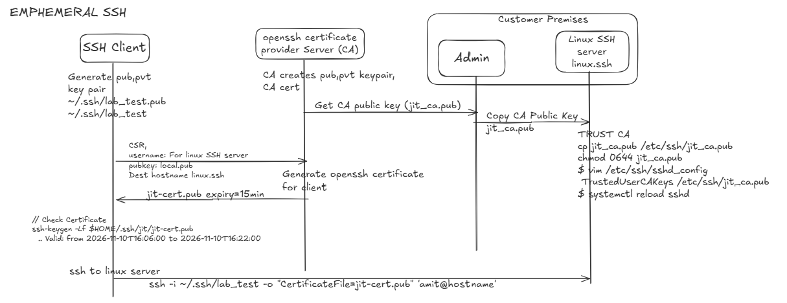

:toc:
:toclevels: 5

= Ephemeral SSH using Certificates / JIT SSH

- This project is a just-in-time (JIT) SSH access Solution. Instead of distributing each user's long-lived public key into target accounts' `~/.ssh/authorized_keys`, it issues short-lived OpenSSH user certificates signed by an SSH certificate authority (CA).

- The intended default maximum certificate lifetime is `15 minutes`. A user generates a temporary `Ed25519 or RSA` keypair on their client; the private key stays on that client, while the public key is sent to the `JIT-SSH`. `JIT-SSH` signs the public key & provides user certificate containing the requesting identity and permitted target account. 

- User then connects directly to the target over SSH using the key and certificate. The target's `sshd` trusts the CA public key and validates the certificate, principal, and validity period.

- This project is intended to make short-lived SSH access practical for teams that want an OpenSSH-native workflow without adopting a full privileged access management (PAM) platform solely to issue SSH credentials. 

- CyberArk documents OpenSSH-based authentication as part of its PAM offering (link:https://docs.cyberark.com/pam-self-hosted/latest/en/content/pasimp/configuring-authentication-methods.htm[CyberArk documentation]). That can be the right choice when an organization needs an integrated PAM program: centralized credential management, policy and approvals, session controls, auditing, and other enterprise workflows.

- This project's intended niche is narrower: teams that primarily need short-lived SSH certificates and prefer a small, purpose-built service they can operate alongside their existing identity and infrastructure.

== Potential advantages of product

- **Operate narrower:** SSH CA issuer provinding certs to SSH Clients rather than introducing a broad PAM platform when SSH certificate issuance is the immediate requirement.
- **Short-lived credentials:** certificates expire automatically according to their validity window, reducing reliance on long-lived client credentials. 
- **Direct session path:** after certificate issuance, the client connects to the target. An inline SSH session proxy is not required by this design.
- **Small, inspectable scope:** the intended product is limited to certificate issuance and client setup, with room to integrate an organization's existing identity and policy systems.
- **Centralized Certificate Issuance:** central entity controls the certificate issuance and public key management.

== WorkFlow
- SSH Client will generate public, pvt keys
- `Go Engine` is Signing CA and listening on 8080
- SSH Client will request open-ssh certificate from `GO ENGINE` using its public key on endpoint `/api/v1/request-access`
- `GO ENGINE` will generate a OpenSSH certificate for SSH Client expiring in 15 minutes.
- SSH Client will login using certificate to Linux Server

The intended maximum certificate lifetime is 15 minutes. OpenSSH validates the certificate's signature, validity period, and principal when the client authenticates. The engine is involved in certificate issuance, not in the SSH session's data path.

== Comparison with Enterprise PAM(CyberArk, BeyondTrust)

Enterprise PAM deployments are configurable and may offer capabilities beyond SSH key management.

|===
| Area | This JIT SSH design | Common PAM deployment pattern
| SSH credential | Client-held private key plus a short-lived CA-signed user certificate | May broker or retrieve credentials managed in a vault, including static SSH credentials
| Lifetime | Issued certificate is capped at 15 minutes by the engine; OpenSSH checks its validity when authenticating | A vaulted credential may remain usable until rotation, expiry, or policy action; schedules vary
| Target trust | One CA trust entry, `TrustedUserCAKeys /etc/ssh/jit_ca.pub`; no per-user key distribution is needed for this flow | Depending on configuration, public keys or managed accounts may need to be provisioned on target systems
| SSH data path | Client connects directly to the target after certificate issuance | Some deployments route sessions through an inline session proxy or jump host; others may use different designs
| Operational trade-off | Lightweight SSH-specific issuance and direct connectivity; the organization must build identity, authorization, audit, and CA operations around it | Broader PAM workflows and controls, with the operational and infrastructure footprint of the selected deployment
|===

== Intended users and boundaries

The intended operators are teams that want short-lived SSH certificate-based access to managed Linux hosts and can operate an SSH CA securely.

- A Go daemon that loads or creates an Ed25519 SSH CA and signs user certificates.
- An API endpoint for certificate requests.
- A CLI that creates a temporary Ed25519 keypair, requests a certificate, writes the resulting key and certificate to the user's SSH directory, and prints a direct SSH command.
- Target-side OpenSSH CA trust configuration and test coverage.

Not yet implemented:

- How the caller authenticates to the API or how identities and target accounts are authorized.
- HTTPS termination and certificate management. The requirements mention both HTTP port 8080 and HTTPS signing; these must be reconciled before deployment outside a trusted local boundary.
- Approval policy, audit retention, rate limiting, certificate revocation, multi-tenant isolation, high availability, and CA rotation.
- Whether distribution is one executable with daemon/client subcommands or separate daemon and CLI executables built from one Go module.

== Using JIT SSH

- Product is live on link:https://proto-ephemeral-ssh.onrender.com/[Render].

== Scope and status

The Go module currently implements the CA lifecycle and issuance API, along with a CLI for requesting and storing certificates. API authentication and authorization, audit policy, revocation, CA rotation, and production transport security are not implemented and must not be assumed to exist.

The initial requirements also mention an HTTP listener on port 8080 and HTTPS certificate signing. Before remote deployment, the transport must be made consistent and protected with TLS (directly or through a trusted TLS-terminating proxy). The identity in a request body must not be treated as authenticated identity by itself.

== Other Documentation
=== link:./docs/arhitecture.adoc[The Architecture]
=== link:./docs/ConnectToSSHServer.adoc[Connect to SSH Server]
=== link:./docs/DeployOnRender.adoc[Deploy on Render]
=== link:./docs/Test.adoc[Testing Server, Client locally]
