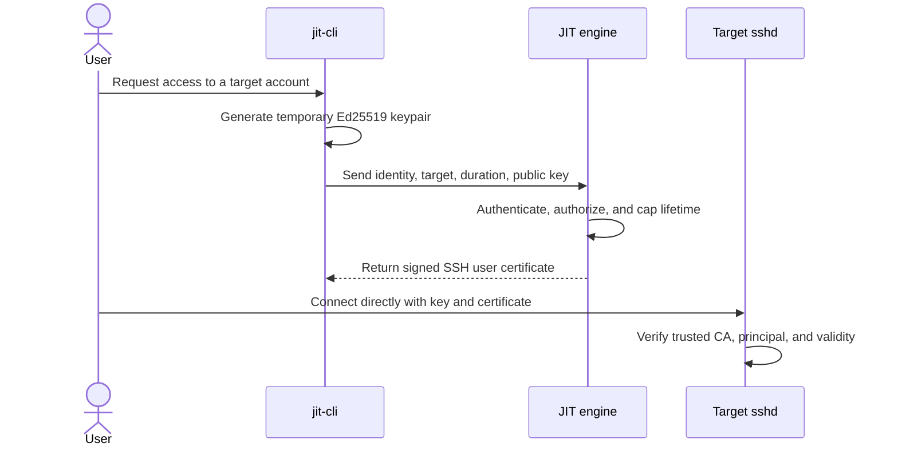

# proto-ephemeral-ssh

**A focused, self-hosted just-in-time SSH certificate issuer.**

This project is intended to make short-lived SSH access practical for teams that want an OpenSSH-native workflow without adopting a full privileged access management (PAM) platform solely to issue SSH credentials. It is not based on the premise that CyberArk or other PAM products cannot support OpenSSH authentication.

CyberArk documents OpenSSH-based authentication as part of its PAM offering ([CyberArk documentation](https://docs.cyberark.com/pam-self-hosted/latest/en/content/pasimp/configuring-authentication-methods.htm)). That can be the right choice when an organization needs an integrated PAM program: centralized credential management, policy and approvals, session controls, auditing, and other enterprise workflows. This project's intended niche is narrower: teams that primarily need short-lived SSH certificates and prefer a small, purpose-built service they can operate alongside their existing identity and infrastructure.

## What it is intended to do

The planned Go engine issues OpenSSH user certificates for client-generated public keys. The CLI creates a temporary Ed25519 keypair, sends only its public key to the engine, receives a CA-signed certificate, and uses that certificate to connect directly to the target host.

The target trusts the SSH CA public key rather than maintaining an entry for every user's key in `authorized_keys`:

```text
TrustedUserCAKeys /etc/ssh/jit_ca.pub
```

The intended maximum certificate lifetime is 15 minutes. OpenSSH validates the certificate's signature, validity period, and principal when the client authenticates. The engine is involved in certificate issuance, not in the SSH session's data path.



## Why this project exists

The goal is not to reproduce all of CyberArk or BeyondTrust. It is to offer a deliberately small alternative for the specific case where a team wants **JIT SSH certificate issuance and direct OpenSSH access**, and considers a larger PAM deployment or integration more operational scope than that use case requires.

Potential advantages for that case:

- **Narrower operational footprint:** operate an SSH CA issuer and CLI rather than introducing a broad PAM platform when SSH certificate issuance is the immediate requirement. Actual effort depends on deployment and existing infrastructure.
- **Native OpenSSH trust:** targets use OpenSSH's CA trust mechanism; per-user public-key distribution for this access flow is unnecessary.
- **Short-lived credentials:** certificates expire automatically according to their validity window, reducing reliance on long-lived client credentials. Short lifetime is not a substitute for revocation, identity verification, or authorization.
- **Direct session path:** after certificate issuance, the client connects to the target. An inline SSH session proxy is not required by this design, though network policy can still require one.
- **Small, inspectable scope:** the intended product is limited to certificate issuance and client setup, with room to integrate an organization's existing identity and policy systems.

This is a trade-off, not a universal improvement. Enterprise PAM may provide important capabilities—such as session recording, approval workflows, credential vaulting and rotation, and centralized governance—that this project does not currently specify. Choose PAM when those controls are required; consider this project when the SSH certificate workflow itself is the requirement and the team is prepared to own the surrounding controls.

## Planned request flow

1. The user invokes `jit-cli access` with a target account, host, and requested duration.
2. The CLI generates an ephemeral Ed25519 keypair. The private key remains on the client; only the public key is sent to the engine.
3. The engine authenticates the requester, authorizes access to the requested target account, and signs a user certificate with a server-enforced lifetime of no more than 15 minutes.
4. The CLI stores the private key and certificate locally with restrictive permissions and prints a direct SSH command.
5. The target's `sshd` accepts certificates signed by the configured CA, subject to normal OpenSSH account and policy checks.

## Scope and status

This repository describes the intended product and its development plan. The implementation is not yet present. In particular, API authentication and authorization, audit policy, revocation, CA rotation, and production transport security must be designed; they should not be assumed to exist.

The initial requirements also mention an HTTP listener on port 8080 and HTTPS certificate signing. Before remote deployment, the transport must be made consistent and protected with TLS (directly or through a trusted TLS-terminating proxy). The identity in a request body must not be treated as authenticated identity by itself.

See [the product overview](./docs/README.md), [the architecture](./docs/architecture.md), and the [phased development TODO](./TODOList.md) for more detail and testable milestones.
