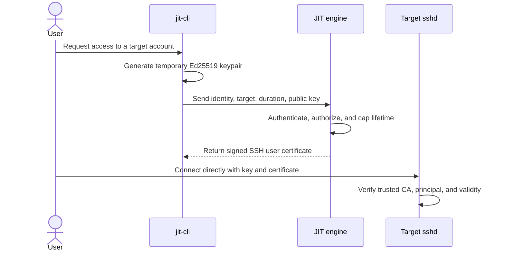

# proto-ephemeral-ssh

**A focused, self-hosted just-in-time SSH certificate issuer.**

This project is intended to make short-lived SSH access practical for teams that want an OpenSSH-native workflow without adopting a full privileged access management (PAM) platform solely to issue SSH credentials. It is not based on the premise that CyberArk or other PAM products cannot support OpenSSH authentication.

CyberArk documents OpenSSH-based authentication as part of its PAM offering ([CyberArk documentation](https://docs.cyberark.com/pam-self-hosted/latest/en/content/pasimp/configuring-authentication-methods.htm)). That can be the right choice when an organization needs an integrated PAM program: centralized credential management, policy and approvals, session controls, auditing, and other enterprise workflows. This project's intended niche is narrower: teams that primarily need short-lived SSH certificates and prefer a small, purpose-built service they can operate alongside their existing identity and infrastructure.

## What it is intended to do
- SSH Client will generate public, pvt keys
- "Go Engine" is Signing CA and listening on 8080
- SSH Client will request open-ssh certificate from "GO ENGINE" using its public key on endpoint "/api/v1/request-access"
- "GO ENGINE" will generate a OpenSSH certificate for SSH Client expiring in 15 minutes.
- 
The target trusts the SSH CA public key rather than maintaining an entry for every user's key in `authorized_keys`:

```text
TrustedUserCAKeys /etc/ssh/jit_ca.pub
```

The intended maximum certificate lifetime is 15 minutes. OpenSSH validates the certificate's signature, validity period, and principal when the client authenticates. The engine is involved in certificate issuance, not in the SSH session's data path.



## Why this project exists

The goal is not to reproduce all of CyberArk or BeyondTrust. It is to offer a deliberately small alternative for the specific case where a team wants **JIT SSH certificate issuance and direct OpenSSH access**, and considers a larger PAM deployment or integration more operational scope than that use case requires.

Potential advantages for that case:

- **Narrower operational footprint:** operate an SSH CA issuer and CLI rather than introducing a broad PAM platform when SSH certificate issuance is the immediate requirement. Actual effort depends on deployment and existing infrastructure.
- **Native OpenSSH trust:** targets use OpenSSH's CA trust mechanism; per-user public-key distribution for this access flow is unnecessary.
- **Short-lived credentials:** certificates expire automatically according to their validity window, reducing reliance on long-lived client credentials. Short lifetime is not a substitute for revocation, identity verification, or authorization.
- **Direct session path:** after certificate issuance, the client connects to the target. An inline SSH session proxy is not required by this design, though network policy can still require one.
- **Small, inspectable scope:** the intended product is limited to certificate issuance and client setup, with room to integrate an organization's existing identity and policy systems.

This is a trade-off, not a universal improvement. Enterprise PAM may provide important capabilities—such as session recording, approval workflows, credential vaulting and rotation, and centralized governance—that this project does not currently specify. Choose PAM when those controls are required; consider this project when the SSH certificate workflow itself is the requirement and the team is prepared to own the surrounding controls.

## Render deployment and web flow

The daemon serves the access homepage at `/`, the product rationale at `/why`, the CA public key download at `/ca.pub`, and the signing API at `/api/v1/request-access`. The Render blueprint in [`render.yaml`](./render.yaml) builds the Docker image and mounts a persistent disk at `/var/data`, where the CA key is stored. The CA private key must survive redeployments; do not use an ephemeral filesystem for it.

The homepage's Contact Us form opens the visitor's email application with a message addressed to `test@gmail.com`; it does not send mail directly from the server. The Stars counter is shared by visitors to one running server process and resets when that process restarts.

### Deploy on Render

1. Push this repository to a Git provider connected to your Render account.
2. In Render, choose **New → Blueprint**, select the repository, and apply the `render.yaml` blueprint. Review the service and persistent-disk cost before creating it. Alternatively, create a Docker web service manually, set the disk mount path to `/var/data`, and set `JIT_CA_KEY_PATH=/var/data/ca_key`.
3. Keep the service's `PORT` environment variable set to `8080`; the daemon listens on that port inside the container while Render provides the public HTTPS endpoint. The blueprint configures the health check at `/healthz`.
4. Wait for the service to become healthy. Open the public `https://<service-name>.onrender.com/` URL. The service's public issuer address is the Render hostname, HTTPS, port `443` (not the container port).
5. Download `/ca.pub` from the service. Install that public key on each destination host as `/etc/ssh/jit_ca.pub`, configure `TrustedUserCAKeys /etc/ssh/jit_ca.pub` in `/etc/ssh/sshd_config`, run `sudo sshd -t`, and reload the SSH service (`sshd` or, on some Debian/Ubuntu hosts, `ssh`). Only the CA **public** key belongs on target hosts.

Render's persistent disk preserves the CA identity across deploys. Protect access to that disk and maintain a secure backup of the CA private key. A lost or replaced key changes the CA identity and requires distributing the new public key to every target. Persistent disks are a paid Render feature and generally constrain a service to one running instance; review current Render limits and pricing.

### Request a certificate and connect

Open the service homepage and provide:

- **Destination username**: the existing account on the target machine (for example, `ubuntu`).
- **Destination hostname or IP**: where SSH should connect (for example, `target.example.com`).
- **Duration**: choose 5, 10, or 15 minutes. The issuer enforces a 15-minute maximum.

When you submit the form, your browser generates an ephemeral Ed25519 keypair locally and sends only the public key to the issuer over HTTPS. The browser downloads the private key and signed certificate separately; the private key is not sent to Render. The page then provides one shell command that moves both files from `~/Downloads` under `~/.ssh/jit/`, sets restrictive permissions, and starts SSH directly to the target. If your browser saves downloads somewhere else, update the source paths in that command. The target must trust the issuer CA public key before login will succeed.

The CLI remains available for terminal-only workflows. It generates and stores credentials on the machine where you run it and prints an SSH connection command.

**Security limitation:** the current signing API does not authenticate callers or authorize target accounts; the `identity` value is not proof of identity. Render services are publicly reachable by default. Do not expose this issuer publicly or use it for production access until requester authentication and authorization (and any needed audit, rate limiting, and policy controls) are implemented. HTTPS protects traffic in transit but does not provide caller authorization.

## Planned request flow

1. The user invokes `jit-cli access` with a target account, host, and requested duration.
2. The CLI generates an ephemeral Ed25519 keypair. The private key remains on the client; only the public key is sent to the engine.
3. The engine authenticates the requester, authorizes access to the requested target account, and signs a user certificate with a server-enforced lifetime of no more than 15 minutes.
4. The CLI stores the private key and certificate locally with restrictive permissions and prints a direct SSH command.
5. The target's `sshd` accepts certificates signed by the configured CA, subject to normal OpenSSH account and policy checks.

## Local development

The CLI requests and stores credentials, then prints an SSH command; it does not start the SSH connection itself. Export the CA public key for installation on target machines using the same CA key path as the daemon:

```sh
JIT_CA_KEY_PATH=/tmp/jit-ssh-ca go run ./cmd/jitd --print-ca-public-key > /tmp/jit_ca.pub
```

Install `/tmp/jit_ca.pub` on each target as `/etc/ssh/jit_ca.pub` and configure `sshd` with `TrustedUserCAKeys /etc/ssh/jit_ca.pub`. Only the public key belongs on target machines; keep the CA private key protected on the issuer.

Start the issuer with that same CA key path:

```sh
JIT_CA_KEY_PATH=/tmp/jit-ssh-ca go run ./cmd/jitd
```

In another terminal, request credentials for a target account and host:

```sh
go run ./cmd/jit-cli access \
  --user ubuntu \
  --host target.internal \
  --duration 15m \
  --server http://127.0.0.1:8080
```

The CLI writes `id_jit_ephemeral` and `id_jit_ephemeral-cert.pub` under `~/.ssh/jit/` with restrictive permissions. It defaults the certificate identity to the local username; `--identity` can override the value recorded in the certificate. The printed command connects directly to the target, not to the issuer. The issuer's HTTP endpoint is suitable only on a trusted local boundary; use HTTPS (directly or through a trusted TLS-terminating proxy) for remote deployments. The request's identity field is not authentication.

Run the project checks with:

```sh
make test
make vet
make build

go run ./cmd/jitd --help
go run ./cmd/jit-cli --help
```

## Scope and status

The Go module currently implements the CA lifecycle and issuance API, along with a CLI for requesting and storing certificates. API authentication and authorization, audit policy, revocation, CA rotation, and production transport security are not implemented and must not be assumed to exist.

The initial requirements also mention an HTTP listener on port 8080 and HTTPS certificate signing. Before remote deployment, the transport must be made consistent and protected with TLS (directly or through a trusted TLS-terminating proxy). The identity in a request body must not be treated as authenticated identity by itself.

See [the product overview](./docs/README.md), [the architecture](./docs/architecture.md), and the [phased development TODO](./TODOList.md) for more detail and testable milestones.
