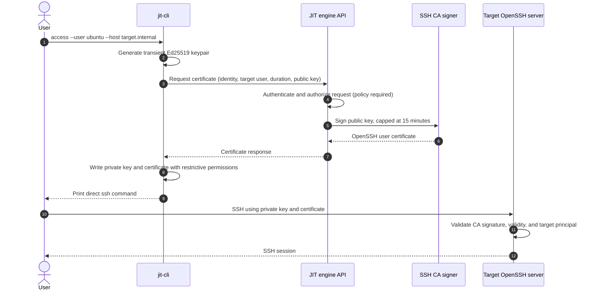

# Architecture

## System context

The system has two distinct paths:

1. **Issuance path:** the CLI sends a public key and access request to the JIT engine. The engine signs a certificate and returns it.
2. **SSH data path:** after issuance, the CLI connects directly to the target host. The engine is not an SSH proxy and is not in this connection's data path.



Certificate issuance and SSH session establishment are separate operations. The user needs connectivity to the engine for issuance and to the target for SSH. The direct SSH connection still has ordinary network latency; the design avoids a mandatory inline SSH proxy hop.

## Component responsibilities

### CLI

- Accept a target account, host, and requested duration.
- Generate an Ed25519 keypair in memory. Only the public key is sent to the engine.
- Request a certificate and validate the response before writing credentials.
- Write the private key and certificate to the documented paths with restrictive permissions.
- Print the SSH command that explicitly selects the key and certificate.

The private key must never be logged or sent to the engine. It remains on the client after issuance; operators should document how users remove it when no longer needed.

### JIT engine

- Load the configured CA key or create it on first startup without overwriting an existing key.
- Parse and validate the submitted public key and request fields.
- Authenticate the caller and authorize the requested identity, principal, and duration before signing. An `identity` string in a JSON body is only a claim until bound to an authenticated caller.
- Sign an OpenSSH user certificate with the identity as `KeyId`, the approved target account as a principal, and a validity period no longer than the configured maximum (15 minutes by default).
- Return the serialized certificate; never return or log client or CA private keys.

OpenSSH capabilities such as `permit-pty` belong in certificate extensions. Critical options should be used only for actual restrictions. Signing policy should default to the minimum required capability set.

### Target host

- Install the CA public key at `/etc/ssh/jit_ca.pub`.
- Configure `sshd` to trust it:

  ```text
  TrustedUserCAKeys /etc/ssh/jit_ca.pub
  ```

- Ensure the certificate principal matches the requested target account and configure any additional account-level SSH policy.

Each target trusts the CA, not every ephemeral client key. The CA private key must remain exclusively in the engine's protected storage; only its public key is distributed to targets.

## Security and operational boundaries

- **Transport:** the requirements specify an HTTP listener on port 8080 but also call for HTTPS signing. Do not expose cleartext HTTP to an untrusted network. Before remote deployment, choose and document native TLS or a trusted TLS-terminating reverse proxy, including how the CLI verifies the endpoint.
- **Authentication and authorization:** implement an explicit caller authentication mechanism and policy that binds authenticated identities to allowed target principals. Do not authorize solely from caller-supplied JSON fields.
- **CA protection:** protect the CA private key with restrictive filesystem permissions and controlled host access; back it up and define rotation and recovery procedures. Loss or compromise of this key affects every target trusting it.
- **Certificate lifetime:** enforce the maximum on the server, not just in CLI validation. `ValidAfter` may include the one-minute clock-skew allowance in the requirements; synchronize clocks and test exact boundaries.
- **Revocation:** a short lifetime limits exposure but is not immediate revocation. Define a KRL or another revocation process if emergency invalidation is required.
- **Audit:** record request outcomes and the authenticated actor, approved principal, and certificate identifier without logging private key material. Define retention and access controls before production.
- **Availability:** target SSH authentication should not require an online engine once a valid certificate has been issued. New issuance depends on engine availability.

## Suggested Go package boundaries

```text
cmd/jitd/             Daemon startup and configuration
cmd/jit-cli/          CLI argument parsing and command output
internal/ca/          CA key lifecycle and certificate signing
internal/server/      HTTP routing, request validation, auth/policy integration
internal/client/      Key generation, API transport, credential file writes
test/integration/     End-to-end tests with disposable OpenSSH configuration
```

Package boundaries are a proposed structure, not an assertion that the code has already been implemented. Keep signing and request validation independently unit-testable, and inject filesystem, clock, and HTTP dependencies where needed to test failure conditions deterministically.

## Delivery and verification

The project roadmap proceeds from building blocks to end-to-end operation:

| Stage | Verifiable outcome |
|---|---|
| Foundation | Go module, daemon/CLI entry points, build and vet |
| CA and signing | CA persistence and verifiable certificate fields/lifetime |
| API | Validated request endpoint with bounded duration and explicit errors |
| CLI | Temporary key handling, secure file writes, and correct SSH command |
| OpenSSH integration | Certificate login to a CA-trusting target without per-key `authorized_keys` setup |
| Operations/docs | Setup and security guidance plus full test/build checks |

For phase-specific commands and acceptance criteria, see [the development TODO](../TODOList.md).
